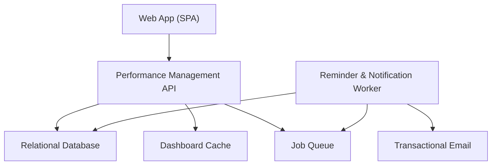
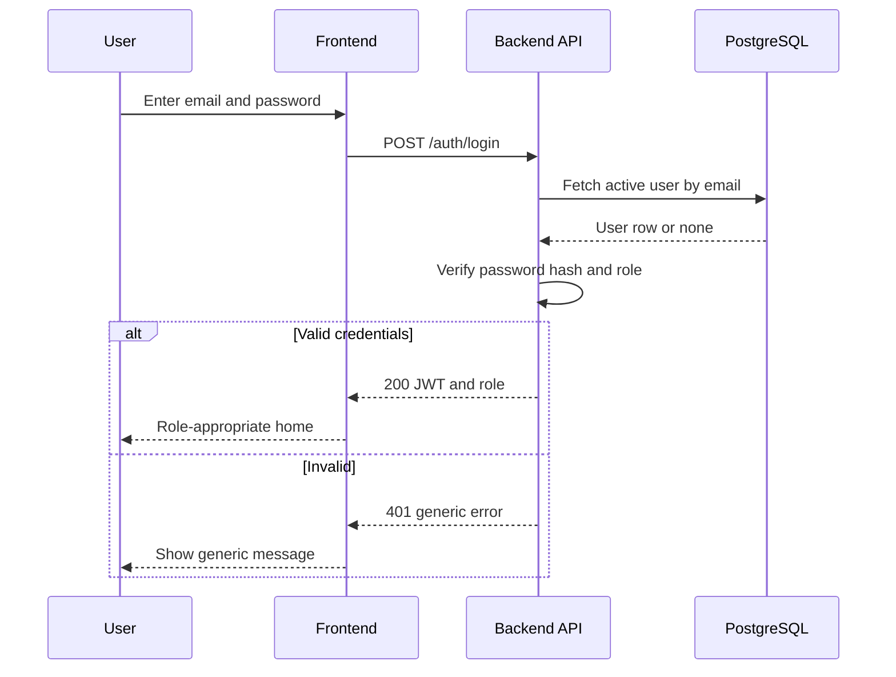
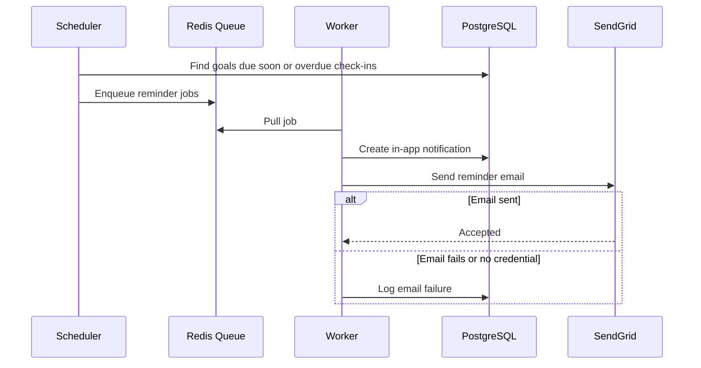
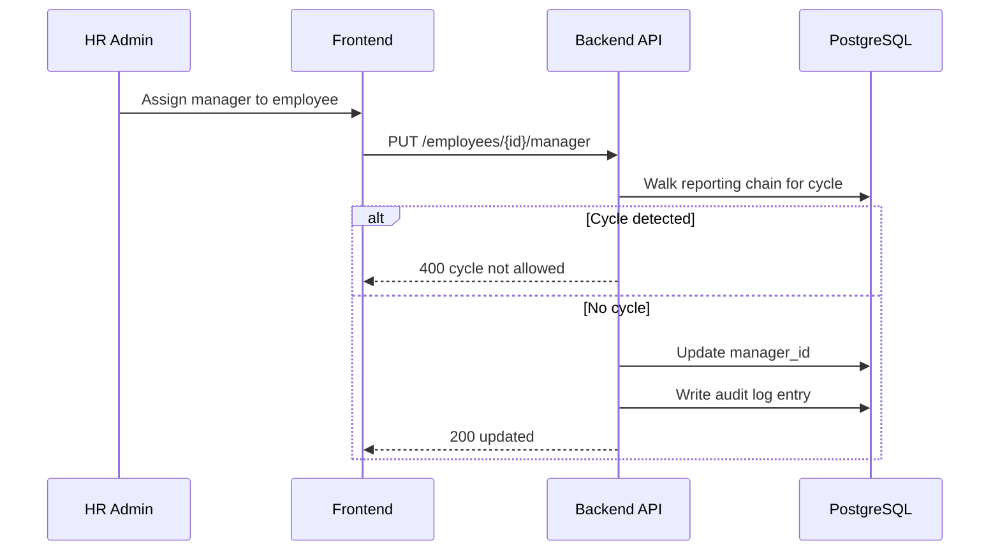
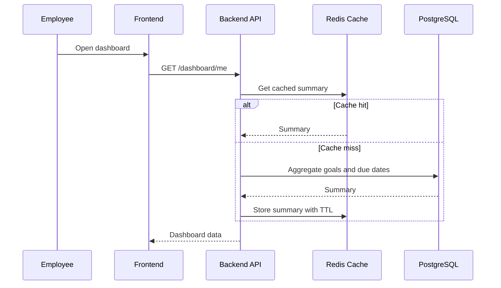
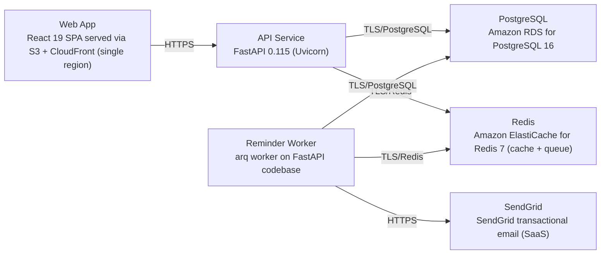

# Architecture

> Maintained by QuorQ AI SDLC. Text between `sdlc:auto` markers is regenerated; anything outside them is yours and is kept.

<!-- sdlc:auto:start narrative -->
## Overview

### ARCH-000 · approved · source: architecture:summary

PMS23 is approved (v1) as a lightweight internal performance management system for one mid-size org (200-1,000 employees), built as a React 19 SPA over a FastAPI REST backend with PostgreSQL as source of truth.

Overall architecture: responsive React 19 SPA talking to FastAPI 0.115 REST API; PostgreSQL 16 holds relational HR/performance data (users, reporting lines, goals cascaded from objectives, check-ins, praise, notifications, audit trail). Redis serves two roles: cache for executive/HR analytics dashboards, and queue backing a background worker for due-date/check-in reminders. Emails go through SendGrid; on email failure the in-app notification is still created and the failure is logged. RBAC (employee, manager, HR admin, executive read-only) gates every endpoint. Hosted in a single AWS region to satisfy data-residency and GDPR-style obligations (export, delete/anonymise, audit).

### ARCH-001 · approved · source: architecture:components:frontend

Web App (SPA) built in React 19 is the single responsive UI for all roles, covering login, goal trackers, dashboards, check-ins, praise, and executive analytics.

Component: Web App (SPA), React 19. Responsibilities: renders login, goal trackers with progress bars, personal and team dashboards, check-ins, praise, and executive analytics; enforces role-appropriate navigation; renders empty states. Chosen as a responsive SPA served via S3+CloudFront.

### ARCH-002 · approved · source: architecture:components:backend_api

Performance Management API (FastAPI 0.115) is the single REST backend implementing auth, RBAC, HR data, goals, check-ins, notifications, praise, dashboards, audit logging and GDPR export/delete.

Component: backend_api, FastAPI 0.115. Implements authentication, RBAC, employee and reporting-line management, goals and objectives, progress and check-ins, notifications, praise, dashboards, audit logging, and GDPR export/delete.

### ARCH-003 · approved · source: architecture:components:worker

Reminder & Notification Worker (arq on FastAPI codebase, Python 3.12) runs scheduled reminder jobs and sends notifications/emails outside the request path.

Component: worker. Processes scheduled due-date/overdue check-in reminders, creates in-app notifications, and sends emails via SendGrid; logs email failures without losing the in-app notification.

### ARCH-004 · approved · source: architecture:components:database

PostgreSQL 16 is the relational system of record for all HR and performance data, including the audit trail.

Component: database, PostgreSQL 16. Stores all relational HR/performance data with referential integrity, supports aggregate queries for dashboards, provides encryption at rest, and is the source of truth for the audit trail.

### ARCH-005 · approved · source: architecture:components:cache

Dashboard Cache (Redis 7) speeds up aggregated dashboard and team-view results during the appraisal period.

Component: cache, Redis 7. Caches aggregated dashboard/team-view results to keep analytics fast during appraisal periods; falls back to PostgreSQL on cache miss (see critical path ARCH-012).

### ARCH-006 · approved · source: architecture:components:queue

Job Queue (Redis 7) holds scheduled and batched reminder jobs so email/notification work runs outside the request path.

Component: queue, Redis 7. Separate logical role from the dashboard cache (same Redis 7 technology) dedicated to holding scheduled/batched reminder jobs for the worker.

### ARCH-007 · approved · source: architecture:components:email

Transactional Email via SendGrid sends reminder, password-reset and feedback emails to internal users.

Component: email, SendGrid (SaaS). Sends reminder, password-reset and feedback emails; chosen for deliverability suited to an internal audience.

### ARCH-008 · approved · source: architecture:critical_paths:Login and role-based access

Login issues a role-carrying JWT after verifying a hashed password, with a generic failure error, and every subsequent request is authorised by role and reporting line.

Critical path: User submits email/password; backend verifies hashed password, issues a JWT carrying the role, and returns a generic error on any failure without revealing which field was wrong. Subsequent requests are authorised per role and reporting line.

### ARCH-009 · approved · source: architecture:critical_paths:Due-date and check-in reminders

A scheduled sweep enqueues reminder jobs for goals due soon or overdue check-ins; the worker always records an in-app notification and attempts email, logging any send failure.

Critical path: A scheduled sweep enqueues reminder jobs for goals due soon or with overdue check-ins; the worker always creates an in-app notification, then attempts a SendGrid email and logs any failure so nothing is silently lost.

### ARCH-010 · approved · source: architecture:critical_paths:Reporting-line change with cycle prevention

HR admin can reassign an employee's manager; the service blocks reassignments that would create a reporting cycle and records an audit entry.

Critical path: HR admin sets or reassigns an employee's manager; the service rejects assignments that would create a cycle, updates access so the previous manager loses visibility, and writes an audit entry.

### ARCH-011 · approved · source: architecture:critical_paths:Personal dashboard with cached aggregates

The personal dashboard serves goal progress and due-date flags from Redis cache first, falling back to a PostgreSQL aggregate query on a cache miss and repopulating the cache.

Critical path: Employee opens their dashboard; the backend serves goal progress and due-date flags from the Redis cache, falling back to a PostgreSQL aggregate query and repopulating the cache on a miss.

### ARCH-012 · approved · source: architecture:entities

Eight relational entities define the data model: users, objectives, goals, check_ins, praise, notifications, password_reset_tokens, and audit_log.

Entities and key fields: users(id, name, email, password_hash, role, manager_id, is_active, anonymised_at, created_at, updated_at); objectives(id, title, description, level, owner_id, created_at); goals(id, owner_id, created_by, parent_objective_id, title, description, target_metric, progress_type, progress_percent, status, check_in_interval_days, due_date, completed_at, created_at, updated_at); check_ins(id, goal_id, author_id, note, created_at); praise(id, sender_id, recipient_id, message, created_at); notifications(id, user_id, type, message, is_read, email_status, created_at); password_reset_tokens(id, user_id, token_hash, expires_at, used_at, created_at); audit_log(id, actor_id, entity_type, entity_id, action, changes, created_at).

### ARCH-013 · approved · source: architecture:endpoints

The REST API defines 23 endpoints covering auth, employee/reporting-line management, GDPR export/delete, audit log, goals/objectives/check-ins, dashboards/analytics, praise, and notifications.

Auth: POST /auth/login (JWT + role, generic failure error), POST /auth/logout, POST /auth/password-reset/request, POST /auth/password-reset/confirm. Employees: POST /employees, PUT /employees/{id}, POST /employees/{id}/deactivate, PUT /employees/{id}/manager (cycle rejection), GET /employees/{id}/export, DELETE /employees/{id}/personal-data (GDPR, audited). Audit: GET /audit-log. Goals/objectives: POST /goals, GET /goals, PUT /goals/{id}, PATCH /goals/{id}/progress (auto-complete at 100%/Completed), POST /goals/{id}/check-ins, GET /goals/{id}/check-ins, GET /objectives. Dashboards/analytics: GET /dashboard/me (cached), GET /dashboard/team (cached), GET /analytics (executive read-only). Praise: POST /praise, GET /praise/received. Notifications: GET /notifications, PATCH /notifications/{id}/read.

### ARCH-014 · approved · source: architecture:deployment_nodes

Deployment is single-region AWS: CloudFront/S3 for the SPA, ECS Fargate for the API and worker containers, RDS for PostgreSQL, ElastiCache for Redis, and SendGrid as an external SaaS dependency.

Nodes: Web App - React 19 SPA served via S3 + CloudFront (single region, static build). API Service - FastAPI 0.115/Uvicorn, Python 3.12 container on ECS Fargate. Reminder Worker - arq worker on the same FastAPI codebase, Python 3.12 container on ECS Fargate. PostgreSQL - Amazon RDS for PostgreSQL 16, managed, encryption at rest, single region. Redis - Amazon ElastiCache for Redis 7 (cache + queue), managed, single region. SendGrid - external transactional email SaaS API.

### ARCH-015 · approved · source: architecture:technology_decisions

Key technology choices: React 19 frontend, FastAPI 0.115 backend, PostgreSQL 16 database, and AWS single-region cloud hosting, each selected over named alternatives for stated reasons.

Frontend: React 19 (vs Vue, Angular) - chosen to build the four interaction-heavy surfaces (goal trackers, multi-step forms, dashboards, praise threads) as a responsive SPA on CloudFront, citing widest developer pool for a tight deadline. Backend: FastAPI 0.115 (vs Django REST Framework, Express) - chosen to express RBAC, configurable goal/check-in rules and the audit trail clearly, with Pydantic validation enforcing permission/form checks before writes. Database: PostgreSQL 16 (vs MySQL, SQL Server) - chosen to enforce the relational model (reporting lines, cascaded goals, objectives, check-ins) and run dashboard aggregates reliably; jsonb stores audit change-sets, row-level control suits sensitive HR data. Cloud: AWS (vs Azure, GCP) - chosen for single-region RDS/ElastiCache/ECS giving dependable hosting, backups, access controls and data-residency for one organisation's HR data.
<!-- sdlc:auto:end narrative -->

<!-- sdlc:auto:start building-blocks -->
## Building Block View

| ID | Name | Technology | Responsibility | Depends on |
|---|---|---|---|---|
| frontend | Web App (SPA) | React 19 | Responsive UI for login, goal trackers with progress bars, personal and team dashboards, check-ins, praise and executive analytics; enforces role-appropriate navigation and renders empty states. | backend_api |
| backend_api | Performance Management API | FastAPI 0.115 | REST API implementing authentication, RBAC, employee and reporting-line management, goals and objectives, progress and check-ins, notifications, praise, dashboards, audit logging and GDPR export/delete. | database, cache, queue |
| worker | Reminder & Notification Worker | FastAPI 0.115 (arq worker, Python 3.12) | Background job runner that processes scheduled due-date/overdue check-in reminders, creates in-app notifications and sends emails via SendGrid, logging failures without losing the in-app notification. | database, queue, email |
| database | Relational Database | PostgreSQL 16 | Stores all relational HR and performance data with referential integrity, aggregate queries for dashboards, and encryption at rest; source of truth for the audit trail. | — |
| cache | Dashboard Cache | Redis 7 | Caches aggregated dashboard/team-view results to keep analytics fast during the appraisal period. | — |
| queue | Job Queue | Redis 7 | Holds scheduled and batched reminder jobs so email/notification work runs out of the request path. | — |
| email | Transactional Email | SendGrid | Sends reminder, password-reset and feedback emails with good deliverability for an internal audience. | — |

<!-- sdlc:auto:end building-blocks -->

<!-- sdlc:auto:start runtime -->
## Runtime View

### Login and role-based access

User submits email/password; backend verifies hashed password, issues a JWT carrying the role, and returns a generic error on any failure without revealing which field was wrong. Subsequent requests are authorised per role and reporting line.

- **Components:** frontend, backend_api, database
- **Modules:** auth.routes, auth.service, auth.security, rbac.dependencies
- **Key functions:** login(email, password), verify_password(raw, hash), create_access_token(user), require_role(roles), can_access_employee(actor, target)

### Due-date and check-in reminders

A scheduled sweep enqueues reminder jobs for goals due soon or with overdue check-ins; the worker always creates an in-app notification, then attempts a SendGrid email and logs any failure so nothing is silently lost.

- **Components:** backend_api, queue, worker, email, database
- **Modules:** reminders.scheduler, reminders.jobs, notifications.service, email.sendgrid_client
- **Key functions:** enqueue_due_reminders(), process_reminder(goal_id, user_id), create_notification(user_id, type, message), send_email(to, template, context)

### Reporting-line change with cycle prevention

HR admin sets or reassigns an employee's manager; the service rejects assignments that would create a cycle, updates access so the previous manager loses visibility, and writes an audit entry.

- **Components:** frontend, backend_api, database
- **Modules:** employees.routes, reporting.service, audit.service
- **Key functions:** set_manager(employee_id, manager_id), would_create_cycle(employee_id, manager_id), record_audit(actor, entity, action, changes)

### Personal dashboard with cached aggregates

Employee opens their dashboard; the backend serves goal progress and due-date flags from the Redis cache, falling back to a PostgreSQL aggregate query and repopulating the cache on a miss.

- **Components:** frontend, backend_api, cache, database
- **Modules:** dashboard.routes, dashboard.service, cache.client
- **Key functions:** get_personal_dashboard(user_id), cache_get(key), cache_set(key, value, ttl), aggregate_goal_summary(user_id)

<!-- sdlc:auto:end runtime -->

<!-- sdlc:auto:start deployment-view -->
## Deployment View

| Name | Service | Runtime | Scaling | Environment |
|---|---|---|---|---|
| Web App | React 19 SPA served via S3 + CloudFront (single region) | Static build | CDN edge cache | dev |
| API Service | FastAPI 0.115 (Uvicorn) | Python 3.12 container on ECS Fargate | Horizontal, 1-3 tasks | dev |
| Reminder Worker | arq worker on FastAPI codebase | Python 3.12 container on ECS Fargate | 1 task + scheduled sweep | dev |
| PostgreSQL | Amazon RDS for PostgreSQL 16 | Managed, encryption at rest, single region | Single instance + automated backups | dev |
| Redis | Amazon ElastiCache for Redis 7 (cache + queue) | Managed, single region | Single node | dev |
| SendGrid | SendGrid transactional email (SaaS) | External API | Managed | dev |

| Source | Target | Protocol |
|---|---|---|
| Web App | API Service | HTTPS |
| API Service | PostgreSQL | TLS/PostgreSQL |
| API Service | Redis | TLS/Redis |
| Reminder Worker | Redis | TLS/Redis |
| Reminder Worker | PostgreSQL | TLS/PostgreSQL |
| Reminder Worker | SendGrid | HTTPS |

<!-- sdlc:auto:end deployment-view -->

<!-- sdlc:auto:start decisions -->
## Architecture Decisions

| Layer | Choice | ADR |
|---|---|---|
| Frontend | React 19 | [ADR-0001](adr/frontend.md) |
| Backend | FastAPI 0.115 | [ADR-0002](adr/backend.md) |
| Database | PostgreSQL 16 | [ADR-0003](adr/database.md) |
| Cloud | AWS | [ADR-0004](adr/cloud.md) |
<!-- sdlc:auto:end decisions -->

<!-- sdlc:auto:start links -->
## Related Documents

- [Data Model](data-model.md)
- [API Specification](api/openapi.yaml)
- [Architecture Decision Records](adr/README.md)
<!-- sdlc:auto:end links -->
