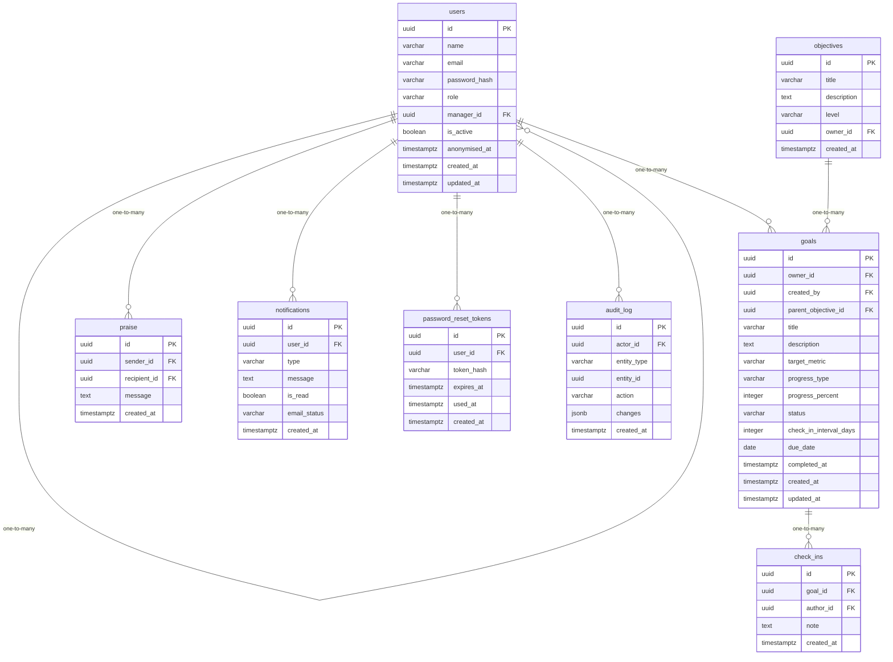

# Data Model

<!-- sdlc:auto:start entities -->
### users

| Field | Type | PK | FK | Nullable |
|---|---|---|---|---|
| id | uuid | True | — | False |
| name | varchar | False | — | False |
| email | varchar | False | — | False |
| password_hash | varchar | False | — | True |
| role | varchar | False | — | False |
| manager_id | uuid | False | users.id | True |
| is_active | boolean | False | — | False |
| anonymised_at | timestamptz | False | — | True |
| created_at | timestamptz | False | — | False |
| updated_at | timestamptz | False | — | False |

### objectives

| Field | Type | PK | FK | Nullable |
|---|---|---|---|---|
| id | uuid | True | — | False |
| title | varchar | False | — | False |
| description | text | False | — | True |
| level | varchar | False | — | False |
| owner_id | uuid | False | users.id | True |
| created_at | timestamptz | False | — | False |

### goals

| Field | Type | PK | FK | Nullable |
|---|---|---|---|---|
| id | uuid | True | — | False |
| owner_id | uuid | False | users.id | False |
| created_by | uuid | False | users.id | False |
| parent_objective_id | uuid | False | objectives.id | True |
| title | varchar | False | — | False |
| description | text | False | — | True |
| target_metric | varchar | False | — | True |
| progress_type | varchar | False | — | False |
| progress_percent | integer | False | — | True |
| status | varchar | False | — | True |
| check_in_interval_days | integer | False | — | True |
| due_date | date | False | — | False |
| completed_at | timestamptz | False | — | True |
| created_at | timestamptz | False | — | False |
| updated_at | timestamptz | False | — | False |

### check_ins

| Field | Type | PK | FK | Nullable |
|---|---|---|---|---|
| id | uuid | True | — | False |
| goal_id | uuid | False | goals.id | False |
| author_id | uuid | False | users.id | False |
| note | text | False | — | False |
| created_at | timestamptz | False | — | False |

### praise

| Field | Type | PK | FK | Nullable |
|---|---|---|---|---|
| id | uuid | True | — | False |
| sender_id | uuid | False | users.id | False |
| recipient_id | uuid | False | users.id | False |
| message | text | False | — | False |
| created_at | timestamptz | False | — | False |

### notifications

| Field | Type | PK | FK | Nullable |
|---|---|---|---|---|
| id | uuid | True | — | False |
| user_id | uuid | False | users.id | False |
| type | varchar | False | — | False |
| message | text | False | — | False |
| is_read | boolean | False | — | False |
| email_status | varchar | False | — | True |
| created_at | timestamptz | False | — | False |

### password_reset_tokens

| Field | Type | PK | FK | Nullable |
|---|---|---|---|---|
| id | uuid | True | — | False |
| user_id | uuid | False | users.id | False |
| token_hash | varchar | False | — | False |
| expires_at | timestamptz | False | — | False |
| used_at | timestamptz | False | — | True |
| created_at | timestamptz | False | — | False |

### audit_log

| Field | Type | PK | FK | Nullable |
|---|---|---|---|---|
| id | uuid | True | — | False |
| actor_id | uuid | False | users.id | True |
| entity_type | varchar | False | — | False |
| entity_id | uuid | False | — | True |
| action | varchar | False | — | False |
| changes | jsonb | False | — | True |
| created_at | timestamptz | False | — | False |
<!-- sdlc:auto:end entities -->

<!-- sdlc:auto:start relationships -->
| Source | Target | Type |
|---|---|---|
| users | users | one-to-many |
| users | goals | one-to-many |
| objectives | goals | one-to-many |
| goals | check_ins | one-to-many |
| users | praise | one-to-many |
| users | notifications | one-to-many |
| users | password_reset_tokens | one-to-many |
| users | audit_log | one-to-many |
<!-- sdlc:auto:end relationships -->

<!-- sdlc:auto:start er-diagram -->

<!-- sdlc:auto:end er-diagram -->
