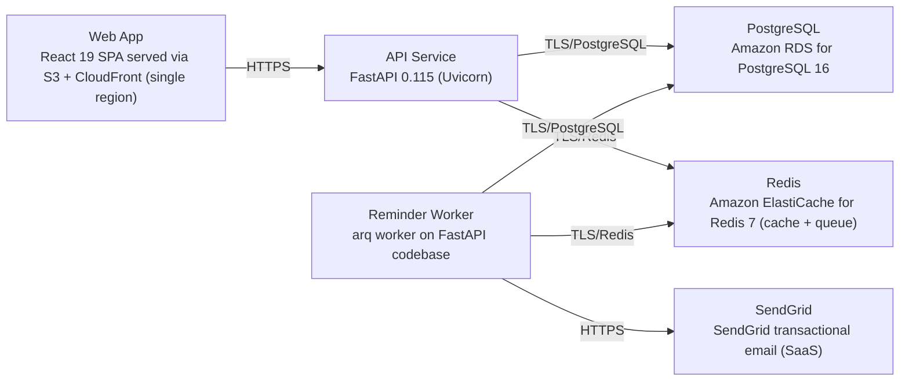

# Deployment Guide

> Maintained by QuorQ AI SDLC. Text between `sdlc:auto` markers is regenerated; anything outside them is yours and is kept.

<!-- sdlc:auto:start how-it-deploys -->
Pushes to `main` run `.github/workflows/deploy.yml`, which builds the API image (if there is a backend) and deploys the SPA to AWS Amplify. Commits touching only `docs/sdlc/**` don't deploy. Deployments can also be started from the platform's Deployment tab.
<!-- sdlc:auto:end how-it-deploys -->

<!-- sdlc:auto:start environments -->
| Name | Service | Runtime | Scaling | Environment |
|---|---|---|---|---|
| Web App | React 19 SPA served via S3 + CloudFront (single region) | Static build | CDN edge cache | dev |
| API Service | FastAPI 0.115 (Uvicorn) | Python 3.12 container on ECS Fargate | Horizontal, 1-3 tasks | dev |
| Reminder Worker | arq worker on FastAPI codebase | Python 3.12 container on ECS Fargate | 1 task + scheduled sweep | dev |
| PostgreSQL | Amazon RDS for PostgreSQL 16 | Managed, encryption at rest, single region | Single instance + automated backups | dev |
| Redis | Amazon ElastiCache for Redis 7 (cache + queue) | Managed, single region | Single node | dev |
| SendGrid | SendGrid transactional email (SaaS) | External API | Managed | dev |
<!-- sdlc:auto:end environments -->

<!-- sdlc:auto:start live -->
_Not deployed yet._
<!-- sdlc:auto:end live -->

<!-- sdlc:auto:start topology -->

<!-- sdlc:auto:end topology -->
